<div align="center">



**Reliable AI systems, from architecture to production.**


</div>

```bash
adrian@vazquezdev:~$ whoami
> Adrián Vázquez — AI Engineer · Barcelona · EU citizen

adrian@vazquezdev:~$ cat mission.md
> I build RAG systems, agents and MCP servers and take them all the way to production.
> Sole AI engineer at CSR Online since Mar 2026, owning 3 AI systems end to end:
> infrastructure, vector database, backend and deployment.

adrian@vazquezdev:~$ ./how-i-work.sh
[OK] Reliable by design — schema-validated LLM outputs, an eval suite guarding every change
[OK] Observable — LLM tracing with Langfuse, Prometheus metrics on deployed services
[OK] Safe by default — human approval before anything irreversible, read-only guard modes, SSRF protection
[OK] End-to-end — vector database, backend, orchestration and UI, delivered with CI/CD

adrian@vazquezdev:~$ cat looking-for.md
> AI Engineer roles (applied AI / LLM engineering) on a team that cares about evals
> and reliability. Full-time, in Barcelona or remote.
```

## Selected work

<table>
<tr>
<td valign="top" width="50%">

### 📋 [ReportAI](https://github.com/avaazquezz/ReportAI)

**Voice note → finished corporate report**, filled into each client's own Word template and delivered on the chat channel the team already uses. No new app, no manual transcribing or formatting.

- LangGraph agent · FastAPI · Claude structured output · Groq Whisper · self-hosted PostgreSQL
- Multi-tenant: templates, document types and channels from an admin panel
- Schema-validated extraction, own eval suite, mandatory human review before sending
- In production: 10–15 reports a month

[**Live demo →**](https://reportai.vazquezlabs.com) · [Code](https://github.com/avaazquezz/ReportAI)

</td>
<td valign="top" width="50%">

### 🔎 [Qdrant-MCP](https://github.com/avaazquezz/Qdrant-MCP)

**The full Qdrant API as 49 MCP tools** — not just store/find. Any MCP client can manage collections, run every search mode and operate a production deployment.

- Hybrid search (RRF/DBSF), grouped, recommend, discover · snapshots · observability
- Opt-in toolsets; read-only mode removes every mutating tool from the registry
- Bring-your-own-Qdrant mode behind an SSRF guard that re-resolves DNS on every call
- `uvx mcp-qdrant` on PyPI · Docker · Claude Desktop bundle · MIT

[**Live console →**](https://mcp-qdrant-web.vazquezlabs.com) · [Code](https://github.com/avaazquezz/Qdrant-MCP) · [PyPI](https://pypi.org/project/mcp-qdrant/)

</td>
</tr>
</table>

**Also public:** [NotaBene](https://github.com/avaazquezz/NotaBene-App) — self-hosted digital lab notebook for research teams (FastAPI, Nuxt, PostgreSQL, Redis, MinIO) · [InakaMoments](https://github.com/avaazquezz/InakaMoments) — public site and SaaS admin panel for an event-decoration business (Nuxt 4, Supabase, Docker).

## Stack

<div align="center">


</div>

| | |
|---|---|
| **AI & LLM** | LangGraph · LangChain · MCP · Pydantic · Langfuse · Claude · OpenAI · Gemini · Groq · Ollama |
| **Retrieval & data** | Qdrant · ChromaDB · pgvector · PostgreSQL · Redis |
| **Backend & DevOps** | Python · FastAPI · Docker · Traefik · Prometheus · CI/CD |
| **Interfaces** | Vue 3 · Nuxt · TypeScript · Vuetify · Tailwind CSS |

Cloud models or fully self-hosted, depending on what the data allows.

---

**Read the code. That's the pitch.** Or skip the README and [talk to Cortex AI](https://brain.vazquezdev.pro), the RAG assistant that already knows this portfolio.

<div align="center">

[](https://vazquezdev.pro)
[](https://brain.vazquezdev.pro)
[](https://www.linkedin.com/in/adrivaz/)
[](mailto:adrian@vazquezdev.pro)
[](https://vazquezdev.pro/CV_AdrianVazquez_EN.pdf)
[](https://vazquezdev.pro/CV_AdrianVazquez_ES.pdf)

</div>
