<div align="center">



**AI Engineer in Barcelona. I build RAG systems, LLM agents and MCP servers that run in production.**<br>
Creator of [ReportAI](https://github.com/avaazquezz/ReportAI), [Qdrant-MCP](https://github.com/avaazquezz/Qdrant-MCP) and [Spanish Laws for RAG](https://github.com/avaazquezz/boe-rag-sync).


</div>

```bash
adrian@vazquezdev:~$ whoami
> Adrián Vázquez — AI Engineer · Barcelona · EU citizen

adrian@vazquezdev:~$ cat mission.md
> I build RAG pipelines, agents and MCP servers and take them all the way to production.
> At CSR Online I'm the sole AI engineer, owning its 3 AI systems in production end to end.
> At VazquezDev, my independent lab, I design, ship and run my own products:
> ReportAI, Qdrant-MCP and Spanish Laws for RAG.
> Same rule in both places: if it doesn't hold up in production, it isn't finished.

adrian@vazquezdev:~$ ./how-i-work.sh   # what the demo doesn't show
[OK] Contracts       — typed boundaries, schema-validated LLM output, stable IDs: any part can be replaced
[OK] Business logic  — the value is in the rules: any law as it stood on any date, deliver → record → charge
[OK] Safeguards      — safe by default: read-only mode, SSRF allowlist, human approval before anything goes out
[OK] Proof           — integration tests, evals, a weekly canary: if it isn't measured, it isn't finished
[OK] Operations      — Docker + Traefik on my own server, releases from CI, a rollback tag before every deploy

adrian@vazquezdev:~$ cat the-loop.md
> I turn a vague request into requirements and trade-offs, then each task into a contract:
> scope, interfaces and the tests it has to pass. AI coding agents implement; I read every diff,
> and major releases also get an independent review. Tests, strict type checking and evals decide.
> AI writes much of the code. I answer for every line.

adrian@vazquezdev:~$ cat looking-for.md
> AI engineering roles (applied AI / LLM engineering), projects and collaborations:
> RAG over company data, agents, MCP integrations or LLM infrastructure that has to work in production.
> Based in Barcelona, open to remote work and relocation.
```

## Selected work

<table>
<tr>
<td valign="top" width="50%">

### [ReportAI](https://github.com/avaazquezz/ReportAI)

**A technician dictates the visit; the report comes out in the company's own Word template.** Built for occupational health and safety inspections, where the report is a legal record. Nothing is sent until a person has checked what the AI understood. v1.1.0, November 2026.

- LangGraph agent checkpointed in Postgres, behind a Postgres job queue · FastAPI · Claude or OpenAI · Groq Whisper · Nuxt
- Every extracted value carries the quote it came from. [Published evals](https://github.com/avaazquezz/ReportAI/blob/main/docs/evals.md) on 83 generated cases: Claude 99.7 % and OpenAI 97.5 % of fields right, zero invented values
- AI assistants use it through an MCP server with its own OAuth 2.1 (Client ID Metadata Documents, PKCE, consent in the panel), connected end to end from claude.ai. Approving and sending stays with a person
- Offline field app; multi-tenant with an isolation test over every route, or one company per server with a one-line installer
- ~900 tests and the whole flow in a browser in CI · about 90 s and under 5 cents of AI per report in the live demo

[**Live demo →**](https://reportai.vazquezlabs.com) · [**Case study →**](https://reportai.vazquezlabs.com/architecture) · [Code](https://github.com/avaazquezz/ReportAI)

</td>
<td valign="top" width="50%">

### [Qdrant-MCP](https://github.com/avaazquezz/Qdrant-MCP)

**The full Qdrant API as 58 MCP tools**, not just store/find. Any MCP client can manage collections, search by meaning or keyword, diagnose search quality and operate a production deployment.

- 6 opt-in toolsets: collections, search, payload, admin, snapshots, observability
- Hybrid search (RRF/DBSF), grouped, recommend, discover — and text search: multilingual semantic (fastembed), BM25, or both
- An advisor: a collection doctor that proposes the exact fix, and a search-quality eval (recall@k, p50/p95)
- Read-only guard mode, refusal of filters that would wipe a collection, SSRF allowlist for snapshot restores
- v2.12 · 766 tests (98% coverage), incl. integration against a real Qdrant · on PyPI, Docker and the [official MCP Registry](https://registry.modelcontextprotocol.io/?q=io.github.avaazquezz%2Fmcp-qdrant), released by CI · MIT

[**Docs →**](https://mcp-qdrant.vazquezlabs.com) · [Code](https://github.com/avaazquezz/Qdrant-MCP) · [PyPI](https://pypi.org/project/mcp-qdrant/)

</td>
</tr>
<tr>
<td valign="top" colspan="2">

### [Spanish Laws for RAG](https://github.com/avaazquezz/boe-rag-sync)

**Spanish law as RAG-ready chunks, kept in sync.** An Apify Actor that turns consolidated Spanish legislation into structure-aware chunks, in the wording in force on any date, and syncs only the changes to your vector store, deletions included.

- The wording in force chosen the way boe.es does it (the later law prevails); editorial notes and repealed text removed
- Incremental sync on Spain's Workers' Statute: a real reform → 7 upserts and 1 delete, 261 chunks untouched; a re-run → 0 operations
- Functional core, tests on real XML from 4 laws, strict mypy, a weekly canary against the live API, 5 decision records · MIT

[**Try it on Apify →**](https://apify.com/vazquezdev/spanish-laws-rag) · [Site](https://spanish-laws.vazquezlabs.com/en) · [Code](https://github.com/avaazquezz/boe-rag-sync)

</td>
</tr>
</table>

**Also public:** [NotaBene](https://github.com/avaazquezz/NotaBene-App) — self-hosted digital lab notebook for research teams (FastAPI, Nuxt, PostgreSQL, Redis, MinIO) · [InakaMoments](https://github.com/avaazquezz/InakaMoments) — public site and SaaS admin panel for an event-decoration business (Nuxt 4, Supabase, Docker).

## Experience

| Role | Where | When |
|---|---|---|
| **AI Engineer** — sole engineer in the AI department | CSR Online | Mar 2026 – present |
| **Independent AI Engineer** — my own AI products | VazquezDev | Oct 2025 – present |
| **Independent Full Stack Product Engineer** — 6 business-management SaaS products | VazquezDev | Sep 2023 – Sep 2025 |
| **Backend & Data Infrastructure Engineer** (internship) | Senyum SL | Sep 2024 – Jul 2025 |

## Stack

<div align="center">


</div>

| Layer | Tools |
|---|---|
| **AI & LLM** | LangGraph · LangChain · MCP · Pydantic · Langfuse · Claude · OpenAI · Gemini · Groq · Ollama |
| **Retrieval & data** | Qdrant · ChromaDB · pgvector · PostgreSQL · Redis |
| **Backend & DevOps** | Python · FastAPI · Node.js · Docker · Traefik · Prometheus · CI/CD |
| **Interfaces** | Vue 3 · Nuxt · TypeScript · Vuetify · Tailwind CSS |

Cloud models or fully self-hosted, depending on what the data allows.

---

**Read the code. That's the pitch.** Or skip the README and [talk to Cortex AI](https://brain.vazquezdev.pro), the RAG assistant that knows my work.

<div align="center">

[](https://vazquezdev.pro)
[](https://www.linkedin.com/in/adrivaz/)
[](mailto:adrian@vazquezdev.pro)
[](https://vazquezdev.pro/CV_AdrianVazquez_EN.pdf)
[](https://vazquezdev.pro/CV_AdrianVazquez_ES.pdf)<br>
[](https://brain.vazquezdev.pro)
[](https://www.instagram.com/vazquezdev.ai/)

</div>
